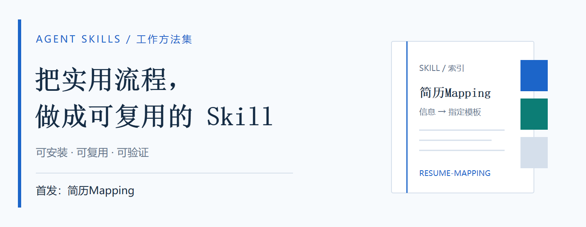

<p align="left"></p>

# Agent Skills

面向日常工作的通用 Agent Skills 集合。把反复执行的方法、规则和工具整理为可以安装、复用和验证的技能，后续持续加入新的 Skill。

[浏览技能](#技能目录) · [安装方法](#安装) · [使用示例](docs/resume-mapping.md#开始使用) · [GitHub](https://github.com/yaoyouzhong/agent-skills) · [Gitee](https://gitee.com/yaoyouzhong/agent-skills)

## 技能目录

| Skill | 解决什么问题 | 输入 | 说明 |
| --- | --- | --- | --- |
| **简历Mapping** · `resume-mapping` | 将现有简历的信息准确填入指定模板，批量统一格式 | 一批原始简历 + 一个目标模板 | [功能、安装与用法](docs/resume-mapping.md) |

## 首发：简历Mapping

投标准备、人员履历整理、多人简历格式转换时，常见的问题是：资料格式不同，目标表格各异，已有内容需要准确落到对应字段。

**简历Mapping 把已有信息映射到用户指定的目标模板。** 支持保留多段教育、任职和项目经历，规范日期，回查未填字段，并检查最终排版。来源未提供足够信息时允许留空，不承诺所有字段都填满。

<p></p>

- **多格式来源**：PDF、Word、Excel 等；旧格式需要现有 Office 或 LibreOffice 转换能力。
- **跟随目标模板**：使用用户提供的 Word 或 Excel 模板，尽量保留表格、字体、边框及分页要求。
- **已有信息尽量填全**：检查最终空项，回查原文，修复漏提和错填；保留项目描述与职责。
- **按需 OCR**：资料文字已足够时不强制识别证书照片；缺项或冲突时再针对相关页面补证。
- **可复用的批处理**：缓存已完成环节，支持增量执行；首次处理耗时取决于原文复杂度、模板和人工判断量，不保证首次提速。

具体格式与运行条件见[能力范围](docs/resume-mapping.md#能力范围与运行条件)。

## 安装

把下面这段话发给你正在使用的 AI Agent：

```text
请从 https://github.com/yaoyouzhong/agent-skills 安装简历Mapping Skill，
Skill 目录是 skills/resume-mapping。
请先读取该目录的 SKILL.md 和 INSTALL.md，按当前客户端的真实技能目录安装，
检查运行环境并完成包内自测，告诉我安装结果和仍缺少的能力。
```

也可以把仓库地址替换为 `https://gitee.com/yaoyouzhong/agent-skills`，或将 [ZIP 安装包](https://github.com/yaoyouzhong/agent-skills/releases/download/resume-mapping-v8.0.0/resume-mapping-v8-universal.skill.zip)交给 Agent，说“请安装这个 Skill”。[Gitee 包下载](https://gitee.com/yaoyouzhong/agent-skills/raw/main/dist/resume-mapping-v8-universal.skill.zip) · [SHA-256 校验值](dist/SHA256SUMS)

不限定三个或几个客户端，也不要求安装 Codex。客户端需要支持加载本地 Skill、读写文件、执行工具，并具备最终页图检查能力；只有聊天能力的大模型不能仅凭一句话安装和运行本地脚本。安装方法由宿主确定，不按模型名称猜路径。

安装后只需提供两项资料：

```text
用简历Mapping，把【原始简历文件夹或附件】中的简历，
按照【目标简历模板路径或附件】整理。
已有信息准确填写；缺少依据的字段留空；保留全部项目和教育经历；
检查剩余空项与最终排版，输出到【结果目录】。
```

## 资料与隐私

本仓库只包含通用代码、说明、安装包和合成测试，不包含真实简历、客户模板或个人测试资料。实际业务资料及输出应放在仓库之外。

脚本读取本地文件，不会自动上传原始简历。AI 客户端及模型服务是否发送、保存内容，取决于使用者选择的产品和配置；使用前按所在单位的资料管理要求选择环境。

## 集合结构

```text
skills/resume-mapping/   Skill 入口、脚本、参考与合成测试
docs/                   每个 Skill 的使用说明
assets/                 公开主页图片，均不使用业务资料
dist/                   可分发安装包与校验值
```

新增 Skill 放到独立的 `skills/<skill-id>/` 目录，并补齐用途、输入输出、安装说明和必要验证。每个 Skill 独立发布；当前首发版本为 **简历Mapping v8**，发布标签 `resume-mapping-v8.0.0`。代码与安装包在 [GitHub](https://github.com/yaoyouzhong/agent-skills) 和 [Gitee](https://gitee.com/yaoyouzhong/agent-skills) 同步提供。
