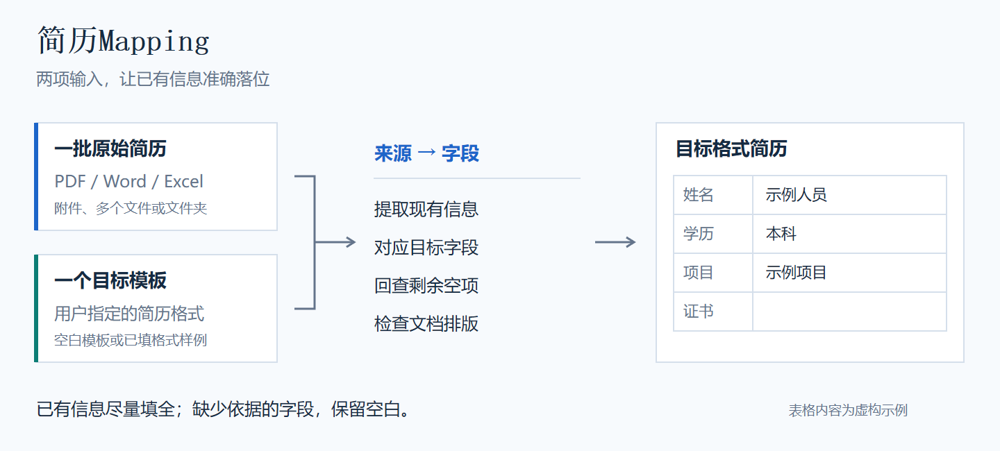

# 简历Mapping

**把已有简历信息准确映射到用户指定的目标模板。**

[返回技能集合](../README.md) · [Skill 入口](../skills/resume-mapping/SKILL.md) · [安装说明](../skills/resume-mapping/INSTALL.md) · [下载 v9 ZIP](https://raw.githubusercontent.com/yaoyouzhong/agent-skills/main/dist/resume-mapping-v9-universal.skill.zip)



## 适合什么场景

- 投标人员资料转换：把多人、不同来源的简历填入本次投标要求的格式。
- 人员简历整理：把 PDF、Word、Excel 中的履历统一到指定表格。
- 更换目标格式：沿用已有资料，重新识别新的目标字段，检查信息是否准确落位。

用户无需准备结构化 JSON、字段映射文件或核对表。Agent 在执行过程中完成来源提取、模板识别和内部核验。

## 开始使用

安装后提供**一批原始简历**和**一个目标简历格式**。可以直接给附件，也可以给 Agent 能访问的本地路径。目标既可以是空白模板，也可以是用户指定的已填格式样例；不会自动沿用上次模板。

```text
用简历Mapping处理这批简历。
原始资料：【文件夹路径或附件】
目标模板：【模板路径或附件】
输出目录：【结果目录】
请保留全部项目、教育和工作经历，将已有信息准确填入对应字段，
规范日期，逐项回查剩余空项，并检查最终文档排版。
```

缺少哪项输入，Agent 才提示补充哪项。批量生成前先检查最长、最短样本；完成后回查目标空项，进行实际渲染和页图检查。遇到损坏、加密、无法解析的文件会报告，不能把读取失败当成“没有资料”。

例如只提供了原始简历时，Agent 会提示：“请提供本次目标简历模板，可以是空白模板或已填格式样例。”已提供模板时不会再次索要。输出目录可选，未指定时使用独立目录，保留原件。

主要交付为目标格式简历；执行过程中可能产生结构化数据、来源引用和核验记录，用于追溯与修复，不要求用户手工编辑。

## 怎样处理信息

| 内容 | 处理规则 |
| --- | --- |
| 空项 | 先检查现有来源是否足够；漏提就修复，缺乏依据则保留空白 |
| 日期 | 统一格式，保留原有精度，不补造月份和日期 |
| 教育经历 | 支持多段，在目标对应区域分行或分段列出；模板只有一个框时在同一框中逐段排列，保留在读状态 |
| 个人学历与学位 | 绑定最近已确认毕业的同一条教育经历；在读只能列入教育经历。明确学位优先；确实缺失时本科默认学士、硕士研究生默认硕士、博士为博士，大专学位留空；明确无学位时留空 |
| 学历显示 | 仅保留本科、大专、硕士研究生、博士等名称，去掉“统招、全日制、学信网可查”等附加描述，不转放补充区；补充区也不重复列最高学历、最高学位 |
| 项目经历 | 按时间由近到远排列，保持每段日期、项目、客户、描述和职责的对应关系，不限制为模板示例数量 |
| 项目客户 | 优先明确客户名称；为空时从对应项目名称或介绍提取，不把雇主、合作方或产品厂商误作客户 |
| 相关信息补充 | 可依据可靠的本人信息交叉补充，例如有效本人身份证可确定性别；不用姓名或照片猜测 |
| OCR | 仅在相关字段缺失、冲突或扫描资料需要补证时辅助使用；信息已充分时不强制识别所有证书照片 |
| 排版 | 尽量保留模板字体、字号、列宽和边框；不靠删除经历、截断描述或过度缩小字体来压页 |

例如“大专已毕业、本科在读”，个人学历填写“大专”，学位留空；“本科已毕业、硕士在读”，个人学历填写“本科”，学位按该本科记录确定。没有足够依据确认任何已毕业记录时，个人学历和学位留空，教育经历仍保留已有信息。不能只因结束日期已过去就认定已经毕业。

## 能力范围与运行条件

| 环节 | 当前支持与条件 |
| --- | --- |
| 来源 | 优先使用宿主已有工具读取 PDF、Word、Excel 等；扫描页按需看图或 OCR |
| 旧格式 | 使用宿主已有转换能力处理任务副本，不能读取时保留具体问题，不当作空资料 |
| 目标 | 可编辑 DOCX、XLSX；复杂对象、特殊表格或 PDF 目标需单独评估适配 |
| 默认流程 | 模型理解与映射，现有文档工具读写文件，现有预览工具生成目标页图，再回查空项与最终排版 |
| 运行环境 | 复用客户端已有能力；不要求用户安装 Python、Office、LibreOffice、OCR 套件或大型运行包 |
| AI 宿主 | 能加载 Skill、访问资料并调用文件/文档工具；不绑定客户端或模型供应商 |
| 排版检查 | 使用宿主现有预览/渲染及看图能力；需要模板对应字体。不能用另排 HTML 冒充目标文件渲染 |
| 可选脚本 | 宿主已有 Python 和相应库时可辅助计算、精确复制、校验或批处理；不强制所有客户端运行固定管线 |

具体支持的文件类型由本次实际可用工具决定，不因加载 Skill 就声称所有客户端、操作系统、复杂模板都已通过。安装验证采用当前宿主能执行的无隐私读写样例，不强制 Python 自测；结构生成成功不等于最终排版通过。缺少某项工具时先完成其它可做部分，再说明对本次任务的具体影响，不自动安装软件。

缓存可减少相同输入与配置下的重复执行；来源、模板或规则变化会触发相应重做。不能把缓存命中的秒级执行时间当成一批新简历从零完成的耗时，也不承诺首次处理更快。

## 安装与验证

把[集合主页的安装提示](../README.md#安装)交给 Agent；也可直接下载 [GitHub v9 安装包](https://raw.githubusercontent.com/yaoyouzhong/agent-skills/main/dist/resume-mapping-v9-universal.skill.zip)或 [Gitee v9 安装包](https://gitee.com/yaoyouzhong/agent-skills/raw/main/dist/resume-mapping-v9-universal.skill.zip)。解压后以 `resume-mapping/SKILL.md` 为入口，按同目录 `INSTALL.md` 执行。

优先使用宿主原生导入或已有文件工具复制目录，并用现有哈希工具核验清单。已有 Python 时也可选包内安装器；不把它作为统一入口。遇到不同或修改过的已装版本会保留并报告，不静默覆盖。宿主实际发现和加载 Skill 仍需验证。

以下仅供已有 Python 环境、选择脚本实现的开发者做可选回归，不是普通用户安装步骤：

```text
python skills/resume-mapping/tests/test_pipeline.py --workdir OUTSIDE_REPO_TEST_DIR
```

更多测试位于 `skills/resume-mapping/tests/`，覆盖规则、来源质量、模板、安装、批处理和回查。测试资料均在运行时合成；这些自测不能代替用户本次真实来源、目标模板与最终页图验收。

## 本轮验证范围

v9 在 2026-10-21 完成本轮验证：

- 同一批 82 份真实简历（32 份 PDF、50 份 Excel），分别按两种 Word 目标模板完整转换，产出 4 份汇编、共 723 页。
- 回查实际目标空项及非空字段的来源归属，检查教育、任职、项目记录和长描述是否准确落位，修复已发现的漏提、错填及分页问题。
- 最终文件完成实际渲染和全部页图核验；仅复用此前已实际看过并通过、无待修问题且像素完全一致的页面，变更页重新查看。
- 17 组合成回归、187 项检查通过；安装包清单、69 个文件和 SHA-256 一致，原始资料保持不变。
- 实际环境为 Windows，复用客户端随附 Python/Node、现有文档库和已安装的 Word/Excel。本轮没有新增软件安装；另以无 Python 安装器的本地复制方式核验最终包及入口加载，不将其等同于所有客户端的全局安装验收。

上述结果覆盖这批来源与两种 Word 模板；Mac、其它 AI 客户端、其它模板及复杂 Excel 目标仍需实际验证。正常缺失或来源冲突保留，不以字段填满率冒充准确率，也不将本轮核验等同于学历或证书的在线真实性认证。真实资料和完整内部核验记录不随仓库公开。

## 版本与公开内容

当前版本 **v9**，技术标识 `resume-mapping`，代码与说明位于 GitHub、Gitee 的 `main` 分支，安装包为 `dist/resume-mapping-v9-universal.skill.zip`（约 200 KB）。它包含规则、参考、可选脚本和合成测试，不捆绑模型或大型运行时。校验值见 [SHA256SUMS](../dist/SHA256SUMS)。

公开代码中使用合成示例，不附带任何真实人员简历或客户模板。业务资料与生成结果应放在集合仓库之外。

脚本不自动上传原始文件；Agent 读取资料后的传输、保存和模型处理方式由所用客户端和服务决定。
